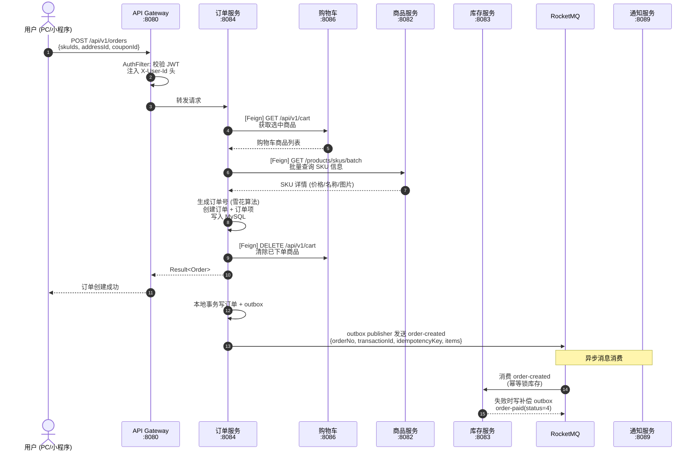
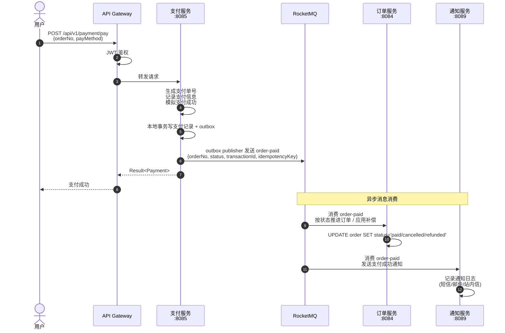
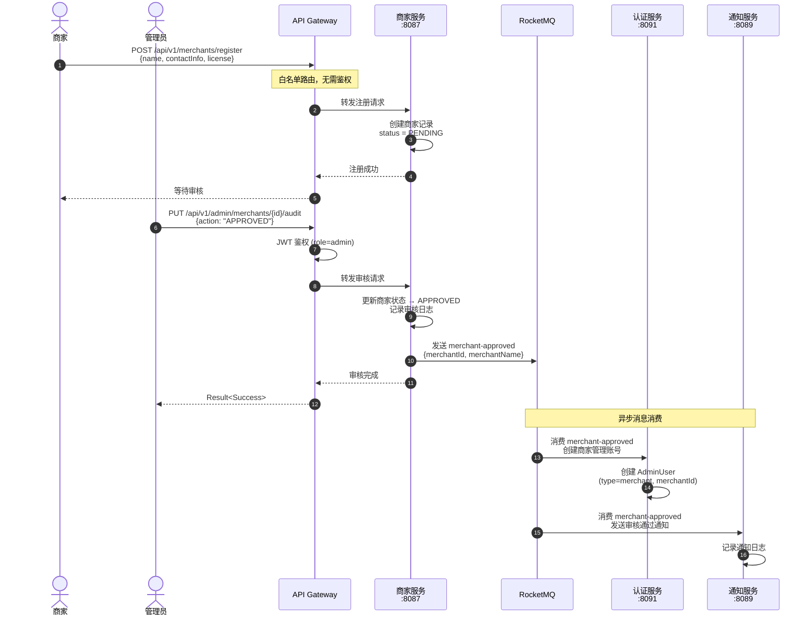
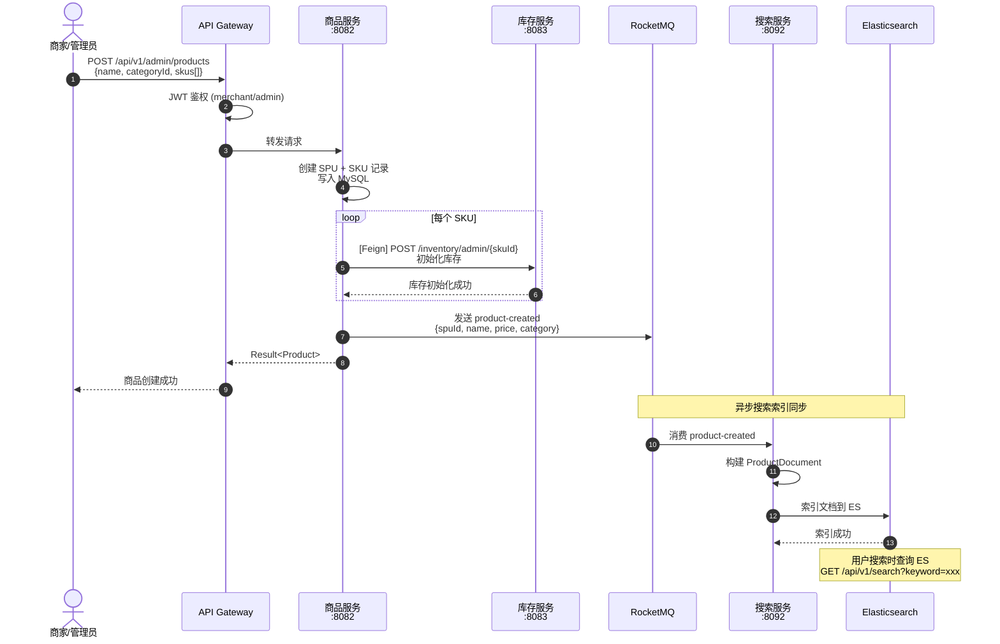
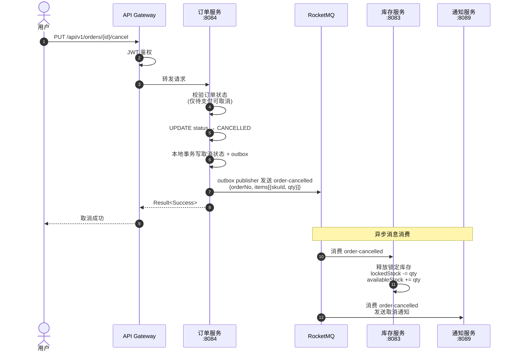
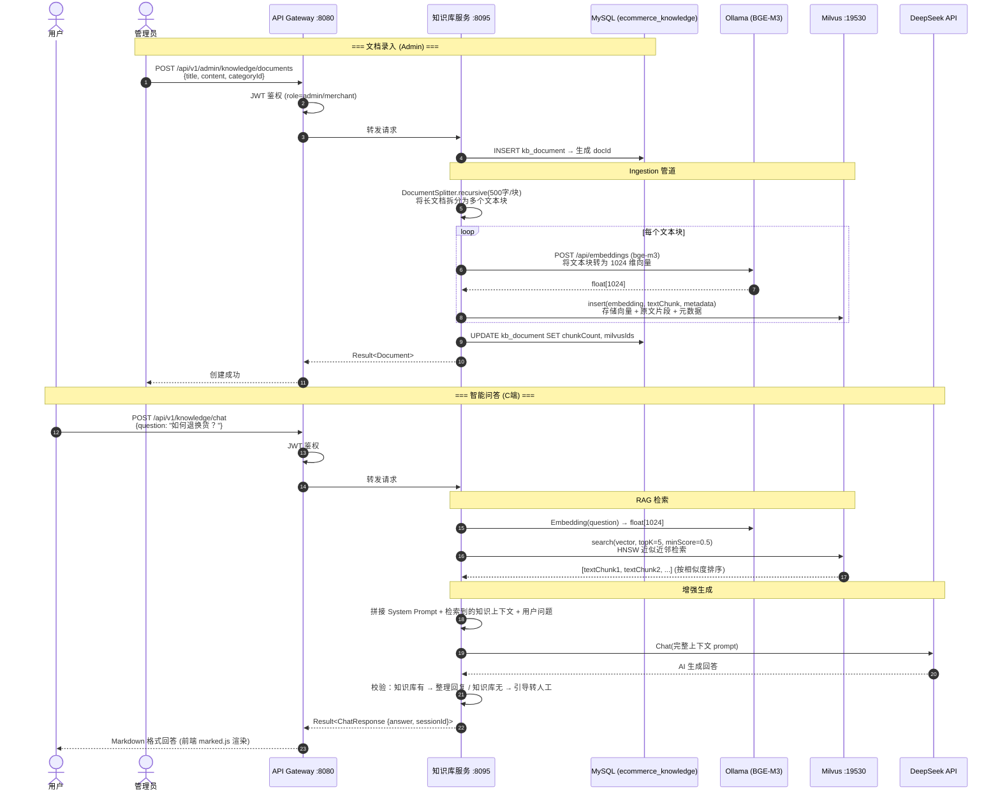

# E-Commerce Platform

[English](README.en.md) · [快速开始](#快速开始) · [服务端口](#服务端口) · [系统架构图](#系统架构图)

基于 `Spring Boot 4 + Spring Cloud` 的微服务电商平台，包含：

- PC Web 商城（Nuxt 3）
- Admin 管理后台（Vue 3 + Element Plus）
- 微信小程序（uni-app）
- AI 知识库 / 智能客服模块（`ecommerce-knowledge`）

当前仓库不仅包含传统电商链路，也已经接入了 `Ollama + Milvus + DeepSeek + LangChain4j`，支持平台知识库、商家私有知识库，以及面向 C 端用户的智能客服问答。

## 快速开始

本文以**本机开发环境**为例。Docker 运行中间件，Java 服务和两个 Web 前端在宿主机运行。首次启动按下面的顺序执行，后续启动可以直接复用镜像、数据卷和 JAR。示例服务绑定本机地址，内含演示账号与宽松的开发配置。

### 一键体验商城和后台

在 Linux 或 macOS 安装下表工具和 Python 3，启动 Docker 后，从仓库根目录运行：

```bash
bash scripts/start-demo.sh
```

看到 `Demo ready.` 后，打开 `http://127.0.0.1:3000`，用 `testuser / test123` 登录商城。后台在 `http://127.0.0.1:5173`，演示账号是 `admin / admin123`。脚本会准备样例账号、商品、库存和图片，启动商城与后台。首次启动可能需要构建 MinIO 和 RocketMQ 镜像。这个入口覆盖浏览、加购、下单、模拟支付、商品与库存管理。需要物流、仓储、知识库或离线数据湖时，继续看下面的完整启动步骤。

脚本在前台运行，按 `Ctrl+C` 停止它启动的应用。日志位于 `.build-local/demo/`。中间件继续运行以便下次复用，可以用 `docker compose stop` 停止。Windows 使用下文的 PowerShell 步骤。修改代码和运行回归测试见 [贡献说明](CONTRIBUTING.md)。

### 1. 安装工具并克隆仓库

| 工具 | 建议 |
|---|---|
| Git | 用来克隆仓库 |
| Docker + Compose v2 | macOS、Windows 安装并启动 Docker Desktop；Linux 启动 Docker Engine，并安装 Compose 插件。见 [Docker 安装指南](https://docs.docker.com/compose/install/) |
| JDK 21 | 安装 [Temurin JDK 21](https://adoptium.net/temurin/releases/?version=21) 或等效 JDK；让 `JAVA_HOME` 和 `PATH` 指向该版本 |
| Maven | 使用 [Maven 3.9+](https://maven.apache.org/install.html)，本地启动流程用 Maven 3.9.12 验证过 |
| Node.js 和 npm | 建议 [Node.js 24 LTS](https://nodejs.org/en/download)；使用 22 时至少为 22.12，见 [Vite 8 要求](https://vite.dev/blog/announcing-vite8#node-js-support) |
| 命令行 | Linux/macOS 用 Bash，Windows 示例用 PowerShell 7.2+；Python 3 仅用于下文的可选 Python 命令 |

完整环境建议至少预留 **16 GB 内存和 20 GB 磁盘空间**。首次构建会下载容器镜像、Maven/npm 依赖和可选的模型。当前中间件组合在 Linux/amd64 验证过；ARM 主机遇到 `no matching manifest` 时，先检查对应镜像的架构支持。

克隆后先检查工具版本。`docker version` 应显示客户端和服务端信息，`mvn -v` 应显示 Java 21。

```bash
git clone https://github.com/ZeYuYang1024/ecommerce-platform.git
cd ecommerce-platform

docker version
docker compose version
java -version
mvn -v
node -v
npm -v
```

以下命令默认从仓库根目录执行，除非步骤指定了子目录。PowerShell 中若 `curl` 被解析成别名，请用 `curl.exe`；命令里的 `/dev/null` 换成 `NUL`。

### 2. 拉取镜像、构建 MinIO 和 RocketMQ、启动 Docker 中间件

先拉取五个已有镜像，再构建仓库内的两个镜像。RocketMQ 的 NameServer 和 Broker 共用一个镜像，构建一次即可。

```bash
docker compose pull mysql redis nacos elasticsearch milvus
docker compose build minio
docker compose build rocketmq-namesrv
docker compose up -d --no-build --pull never
docker compose ps
```

| Compose 服务名 | 容器名 | 版本 | 本机端口与用途 |
|---|---|---|---|
| `mysql` | `ecommerce-mysql` | 26.10.0.1 | 3306，业务数据库，`root / root` |
| `redis` | `ecommerce-redis` | 8.12.0 | 6379，购物车和秒杀缓存，密码 `root` |
| `nacos` | `ecommerce-nacos` | 3.3.0 | 8848 注册发现，9848 gRPC，8849 控制台 |
| `rocketmq-namesrv` | `ecommerce-rmq-namesrv` | 5.5.1 | 9876，RocketMQ NameServer |
| `rocketmq-broker` | `ecommerce-rmq-broker` | 5.5.1 | 10911、10909，消息 Broker |
| `minio` | `ecommerce-minio` | RELEASE.2025-10-15T17-29-55Z | 9000 S3 API，9001 控制台，`minio / minioadmin` |
| `elasticsearch` | `ecommerce-es` | 9.5.7 | 9200，商品搜索 |
| `milvus` | `ecommerce-milvus` | 3.0.6 | 19530 向量接口，9091 健康检查；自带嵌入式 etcd |

`docker compose ps` 应显示 **8 个容器**在运行。容器显示 `Up` 后，还需要等待服务完成初始化。按下面的命令检查，MySQL 应返回 `1`、Redis 返回 `PONG`、RocketMQ 列出 `DefaultCluster`，Nacos 返回 `"data":"ok"`，其余 HTTP 检查应成功。

```bash
docker compose exec -T mysql mysql -h127.0.0.1 -uroot -proot -Nse "SELECT 1"
docker compose exec -T redis redis-cli -a root ping
docker compose exec -T rocketmq-broker sh mqadmin clusterList -n rocketmq-namesrv:9876
curl --noproxy "*" -fsS http://127.0.0.1:8848/nacos/v3/admin/core/state/readiness
curl --noproxy "*" -fsS http://127.0.0.1:9200/_cluster/health
curl --noproxy "*" -fsS -o /dev/null http://127.0.0.1:9000/minio/health/live
curl --noproxy "*" -fsS http://127.0.0.1:9091/healthz
```

首次打开 [Nacos 控制台](http://127.0.0.1:8849/) 时，为 `nacos` 用户设置密码。应用注册使用 `8848/9848`，本地 Compose 已为应用客户端关闭认证；设置控制台密码无需修改 Java 配置。如果某项检查失败，先查看 `docker compose ps -a`，再用 `docker compose logs --tail=100 <服务名>` 看该服务的日志。

#### MinIO 怎么打包和使用

[docker/minio/Dockerfile](docker/minio/Dockerfile) 下载固定标签的 [MinIO 社区版源码](https://github.com/minio/minio/releases/tag/RELEASE.2025-10-15T17-29-55Z)，校验 SHA-256，在 Go 容器内编译，再把可执行文件复制到 Debian slim 运行镜像。本机只需要 Docker。RocketMQ 则由 [docker/rocketmq/Dockerfile](docker/rocketmq/Dockerfile) 下载并校验 Apache 的 5.5.1 二进制发行包。

想单独构建或查看 MinIO 时执行：

```bash
docker compose build minio
docker compose up -d --no-build --pull never minio
docker compose exec -T minio minio --version
docker compose logs --tail=60 minio
```

S3 API 地址为 `http://127.0.0.1:9000`，浏览器管理界面在 [9001](http://127.0.0.1:9001/)。用 `minio / minioadmin` 登录。Java 文件服务配置在 [ecommerce-file/application.yml](ecommerce-file/src/main/resources/application.yml)，首次成功上传图片时会创建 `ecommerce` 桶，也可以提前在控制台创建同名桶。试用时可在后台商品编辑页上传一张不大于 10 MB 的图片，再到 MinIO 查看该对象。

需要把镜像传给另一台机器时，第一行在构建机执行，后两行在**相同 CPU 架构**的目标机仓库根目录执行：

```bash
docker save -o ecommerce-minio.tar ecommerce-local/minio:RELEASE.2025-10-15T17-29-55Z
docker load -i ecommerce-minio.tar
docker compose up -d --no-build --pull never minio
```

镜像 tar 只包含软件。上传的文件在 `minio-2025-data` 命名卷里，需要单独备份。

### 3. 首次初始化 MySQL 和 RocketMQ

下面的完整流程只针对**新建的空数据卷**。已有数据先备份并参考[中间件升级指南](docs/middleware-upgrade.md)。仓库里的 `scripts/start-middleware.sh` 和 `scripts/start-middleware.ps1` 只做基础初始化，首次部署请使用这一节的完整步骤。出现 SQL 错误时先看第一条报错；物流和仓储建表脚本不能在同一个库里整段反复执行。

**Linux/macOS（Bash）**

```bash
(
  set -e
  db() { docker compose exec -T mysql mysql -uroot -proot --default-character-set=utf8mb4 "$@"; }
  migrations=docs/sql/migrations

  db < docs/init.sql
  db < ecommerce-knowledge/sql/init.sql
  db < ecommerce-recommendation/sql/init.sql
  db < "$migrations/2026-05-17-merchant-marketing-tenant-columns.sql"
  db ecommerce_inventory < "$migrations/2026-05-28-inventory-event-log.sql"
  db < "$migrations/2026-06-01-member-init.sql"
  db < "$migrations/2026-06-02-member-phase2a-init.sql"
  db < "$migrations/2026-06-02-order-points-reservation.sql"

  db -e "CREATE DATABASE IF NOT EXISTS ecommerce_logistics CHARACTER SET utf8mb4 COLLATE utf8mb4_unicode_ci; CREATE DATABASE IF NOT EXISTS ecommerce_warehouse CHARACTER SET utf8mb4 COLLATE utf8mb4_unicode_ci;"
  db ecommerce_logistics < "$migrations/2026-06-20-logistics-init.sql"
  db ecommerce_logistics < "$migrations/2026-06-20-shipping-template.sql"
  db ecommerce_logistics < docs/sql/seeds/2026-06-20-logistics-provider-seed.sql
  db ecommerce_warehouse < "$migrations/2026-06-20-warehouse-init.sql"

  for schema in ecommerce_inventory ecommerce_order ecommerce_payment ecommerce_logistics ecommerce_warehouse; do
    db "$schema" < "$migrations/2026-05-28-transactional-outbox.sql"
  done
  db < "$migrations/2026-11-28-buyer-after-sale.sql"
  db -Nse "SELECT SCHEMA_NAME FROM information_schema.SCHEMATA WHERE SCHEMA_NAME LIKE 'ecommerce%';"
)
```

**Windows（PowerShell 7.2+）**

```powershell
function Import-ProjectSql([string]$Path, [string]$Schema) {
  $dbArgs = @('compose', 'exec', '-T', 'mysql', 'mysql', '-uroot', '-proot', '--default-character-set=utf8mb4')
  if ($Schema) { $dbArgs += $Schema }
  Get-Content -LiteralPath $Path -Raw -Encoding UTF8 | docker @dbArgs
  if ($LASTEXITCODE -ne 0) { throw "SQL import failed: $Path" }
}

$migrations = 'docs/sql/migrations'
Import-ProjectSql 'docs/init.sql'
Import-ProjectSql 'ecommerce-knowledge/sql/init.sql'
Import-ProjectSql 'ecommerce-recommendation/sql/init.sql'
Import-ProjectSql "$migrations/2026-05-17-merchant-marketing-tenant-columns.sql"
Import-ProjectSql "$migrations/2026-05-28-inventory-event-log.sql" ecommerce_inventory
Import-ProjectSql "$migrations/2026-06-01-member-init.sql"
Import-ProjectSql "$migrations/2026-06-02-member-phase2a-init.sql"
Import-ProjectSql "$migrations/2026-06-02-order-points-reservation.sql"

docker compose exec -T mysql mysql -uroot -proot -e "CREATE DATABASE IF NOT EXISTS ecommerce_logistics CHARACTER SET utf8mb4 COLLATE utf8mb4_unicode_ci; CREATE DATABASE IF NOT EXISTS ecommerce_warehouse CHARACTER SET utf8mb4 COLLATE utf8mb4_unicode_ci;"
if ($LASTEXITCODE -ne 0) { throw 'Could not create databases' }
Import-ProjectSql "$migrations/2026-06-20-logistics-init.sql" ecommerce_logistics
Import-ProjectSql "$migrations/2026-06-20-shipping-template.sql" ecommerce_logistics
Import-ProjectSql 'docs/sql/seeds/2026-06-20-logistics-provider-seed.sql' ecommerce_logistics
Import-ProjectSql "$migrations/2026-06-20-warehouse-init.sql" ecommerce_warehouse

foreach ($schema in 'ecommerce_inventory', 'ecommerce_order', 'ecommerce_payment', 'ecommerce_logistics', 'ecommerce_warehouse') {
  Import-ProjectSql "$migrations/2026-05-28-transactional-outbox.sql" $schema
}
Import-ProjectSql "$migrations/2026-11-28-buyer-after-sale.sql"
docker compose exec -T mysql mysql -uroot -proot -Nse "SELECT SCHEMA_NAME FROM information_schema.SCHEMATA WHERE SCHEMA_NAME LIKE 'ecommerce%';"
```

最后应列出 **16 个 `ecommerce_*` 数据库**。基础 SQL 已包含支付表的订单号唯一索引，空库无需再执行 `2026-05-29-payment-order-unique.sql`。会员等级由会员服务启动时初始化。知识库 SQL 会先建库和分类，是否启动知识库服务可以稍后决定。

确认 `clusterList` 已有 Broker，再创建项目使用的 16 个 RocketMQ Topic。每个 Topic 配置 4 个读队列和 4 个写队列。

**Linux/macOS（Bash）**

```bash
(
  set -e
  for topic in order-created order-cancelled order-paid order-refunded after-sale-refund-requested after-sale-stock-release product-created merchant-approved review-created seckill-order outbound-shipped shipping-dispatched shipping-exception order-delivered warehouse-stock-changed recommendation-signal; do
    docker compose exec -T rocketmq-broker sh mqadmin updateTopic -n rocketmq-namesrv:9876 -c DefaultCluster -t "$topic" -r 4 -w 4
  done
  docker compose exec -T rocketmq-broker sh mqadmin topicList -n rocketmq-namesrv:9876
)
```

**Windows（PowerShell）**

```powershell
$topics = 'order-created order-cancelled order-paid order-refunded after-sale-refund-requested after-sale-stock-release product-created merchant-approved review-created seckill-order outbound-shipped shipping-dispatched shipping-exception order-delivered warehouse-stock-changed recommendation-signal'.Split(' ')
foreach ($topic in $topics) {
  docker compose exec -T rocketmq-broker sh mqadmin updateTopic -n rocketmq-namesrv:9876 -c DefaultCluster -t $topic -r 4 -w 4
  if ($LASTEXITCODE -ne 0) { throw "Topic creation failed: $topic" }
}
docker compose exec -T rocketmq-broker sh mqadmin topicList -n rocketmq-namesrv:9876
```

### 4. 可选：安装 Ollama，并准备知识库

只研究商城、后台或订单链路，可以直接进入下一步。知识库功能需要在**运行 Java 的同一台主机**启动 Ollama，Compose 已包含 Milvus。

| 系统 | 安装与启动 |
|---|---|
| Linux | 按 [Ollama Linux 指南](https://docs.ollama.com/linux) 安装，可执行 `curl -fsSL https://ollama.com/install.sh \| sh`。安装后先请求下面的版本接口，服务没有运行时再执行 `ollama serve`，保持终端打开 |
| macOS | 按 [Ollama macOS 指南](https://docs.ollama.com/macos) 安装并打开 Ollama 应用，照提示启用命令行 |
| Windows | 按 [Ollama Windows 指南](https://docs.ollama.com/windows) 安装并启动 Ollama，重新打开 PowerShell，确认后台程序继续运行 |

拉取 [BGE-M3](https://ollama.com/library/bge-m3)，下载约 1.2 GB。等 `ollama pull` 完成，`ollama list` 应显示 `bge-m3`。

```bash
ollama --version
ollama pull bge-m3
ollama list
```

再调用 [Ollama Embedding API](https://docs.ollama.com/api/embed)，确认返回 **1024 维**，这与仓库里的 Milvus 集合配置一致。

**Linux/macOS（Bash，打印长度需 Python 3）**

```bash
curl --noproxy "*" -fsS http://127.0.0.1:11434/api/version
curl --noproxy "*" -fsS http://127.0.0.1:11434/api/embed \
  -H 'Content-Type: application/json' \
  -d '{"model":"bge-m3","input":"E-commerce documentation smoke check"}' \
  | python3 -c 'import json,sys; print(len(json.load(sys.stdin)["embeddings"][0]))'
```

**Windows（PowerShell 7.2+）**

```powershell
Invoke-RestMethod -NoProxy http://127.0.0.1:11434/api/version
$body = @{ model = 'bge-m3'; input = 'E-commerce documentation smoke check' } | ConvertTo-Json
$result = Invoke-RestMethod -NoProxy http://127.0.0.1:11434/api/embed -Method Post -ContentType 'application/json' -Body $body
$result.embeddings[0].Count
```

本项目的 Ollama 负责生成向量，默认对话模型由 DeepSeek 提供。需要体验完整问答时，在**启动后端所用的同一个终端**设置 `DEEPSEEK_API_KEY`，IDEA 则填在知识库模块的运行配置里。配置项见 [ecommerce-knowledge/application.yml](ecommerce-knowledge/src/main/resources/application.yml)，API 接入说明见 [DeepSeek 文档](https://api-docs.deepseek.com/)。

**Linux/macOS**

```bash
read -rsp 'DeepSeek API key: ' DEEPSEEK_API_KEY
printf '\n'
export DEEPSEEK_API_KEY
```

**Windows（PowerShell 7.2+）**

```powershell
$env:DEEPSEEK_API_KEY = Read-Host 'DeepSeek API key' -MaskInput
```

有 Ollama 和 Milvus 即可尝试上传文档并生成向量。启动知识库服务后，用后台管理员登录 [平台知识库](http://localhost:5173/knowledge)，选择一个分类，创建一篇短文档，等分段数大于 0。配置了有效的对话模型密钥后，再到 [商城智能客服](http://localhost:3000/knowledge) 登录测试问答。密钥只放环境变量或本地运行配置中。

### 5. 构建和启动 Java 服务

回到仓库根目录打包。根 POM 会构建所有模块，随后从每个模块的 `target/` 取可运行 JAR。需要验证代码时先运行 `mvn test`，然后单独执行下面的打包命令。

```bash
mvn '-Dmaven.test.skip=true' clean package
```

在一个专用终端中从根目录运行下面对应的启动块。启用对话时，先在该终端设置 DeepSeek 密钥。默认启动 **19 个**服务。已经完成 Ollama 配置时，按注释启用知识库，共 **20 个**服务。启动日志写到 `.build-local/`。这组命令把物流服务覆盖为 `8098`，避开会员服务的 `8096`，同时向 Nacos 注册本机地址并提供 Redis 密码。

**Linux/macOS（Bash）**

```bash
with_knowledge=0   # 1 = enable AI knowledge service
repo="$PWD"
log_dir="$repo/.build-local"
mkdir -p "$log_dir"

modules=(auth user product inventory cart order payment merchant coupon notification file search recommendation seckill member warehouse logistics monitor)
if [[ "$with_knowledge" == 1 ]]; then modules+=(knowledge); fi
modules+=(gateway)

backend_pids=()
for module in "${modules[@]}"; do
  name="ecommerce-$module"
  jar="$repo/$name/target/$name-1.0-SNAPSHOT.jar"
  if [[ ! -f "$jar" ]]; then printf 'Missing JAR: %s\n' "$jar"; break; fi
  args=(--server.address=127.0.0.1 --spring.cloud.nacos.discovery.ip=127.0.0.1 --spring.data.redis.password=root)
  if [[ "$module" == logistics ]]; then args+=(--server.port=8098); fi
  (cd "$repo/$name" && exec java -XX:ActiveProcessorCount=4 -Xms64m -Xmx384m -jar "$jar" "${args[@]}") \
    >"$log_dir/$name.log" 2>&1 &
  backend_pids+=("$!")
done
```

**Windows（PowerShell）**

```powershell
$withKnowledge = $false   # $true = enable AI knowledge service
$repo = (Get-Location).Path
$logDir = Join-Path $repo '.build-local'
New-Item -ItemType Directory -Path $logDir -Force | Out-Null
$modules = 'auth user product inventory cart order payment merchant coupon notification file search recommendation seckill member warehouse logistics monitor'.Split(' ')
if ($withKnowledge) { $modules += 'knowledge' }
$modules += 'gateway'

$backendProcesses = @()
foreach ($module in $modules) {
  $name = "ecommerce-$module"
  $moduleDir = Join-Path $repo $name
  $jar = Join-Path $moduleDir "target/$name-1.0-SNAPSHOT.jar"
  if (-not (Test-Path -LiteralPath $jar)) { throw "Missing JAR: $jar" }
  $javaArgs = @('-XX:ActiveProcessorCount=4', '-Xms64m', '-Xmx384m', '-jar', ('"{0}"' -f $jar),
    '--server.address=127.0.0.1', '--spring.cloud.nacos.discovery.ip=127.0.0.1',
    '--spring.data.redis.password=root')
  if ($module -eq 'logistics') { $javaArgs += '--server.port=8098' }
  $backendProcesses += Start-Process java -ArgumentList $javaArgs -WorkingDirectory $moduleDir `
    -RedirectStandardOutput (Join-Path $logDir "$name.log") `
    -RedirectStandardError (Join-Path $logDir "$name.err.log") -PassThru
}
```

也可在 IDEA 导入根 `pom.xml`，分别启动模块的 `*Application`。给运行配置增加上面相同的程序参数，尤其是物流的 `--server.port=8098`。例如在根目录单独启动物流服务：

```bash
java -jar ecommerce-logistics/target/ecommerce-logistics-1.0-SNAPSHOT.jar --server.address=127.0.0.1 --spring.cloud.nacos.discovery.ip=127.0.0.1 --spring.data.redis.password=root --server.port=8098
```

先等 Gateway 和商品服务就绪，再验证网关与业务接口：

```bash
curl --noproxy "*" -fsS http://127.0.0.1:8080/actuator/health
curl --noproxy "*" -fsS "http://127.0.0.1:8080/api/v1/products?page=1&size=5"
```

健康检查应显示 `"status":"UP"`；商品接口应返回业务码 `200` 和样例商品。Gateway 健康时，下游仍可能在启动；如果返回 `503`，先查 `.build-local/ecommerce-product.log`，确认商品服务在 Nacos 的健康实例已注册，再重试。

单独排查服务时，按[服务端口](#服务端口)找到该模块，访问 `http://127.0.0.1:端口/actuator/health`，再看对应的 `.build-local/ecommerce-服务名.log`。PowerShell 启动时，标准错误会单独写入 `ecommerce-服务名.err.log`。

### 6. 启动两个前端并登录

在**两个独立终端**从仓库根目录分别执行。`npm ci` 按仓库锁文件安装依赖，启动后保持终端运行。

**商城**

```bash
cd ecommerce-web
npm ci
npm run dev
```

**管理后台**

```bash
cd ecommerce-admin
npm ci
npm run dev
```

两个开发服务器都将 `/api` 请求转发到本机的 Gateway。使用终端显示的地址访问，正常情况下是：

| 页面 | 地址 | 演示账号 |
|---|---|---|
| PC 商城 | [http://localhost:3000](http://localhost:3000) | `testuser / test123` |
| 管理后台 | [http://localhost:5173](http://localhost:5173) | `admin / admin123` |
| 平台知识库 | [http://localhost:5173/knowledge](http://localhost:5173/knowledge) | 平台管理员 |
| 商家知识库 | [http://localhost:5173/merchant/knowledge](http://localhost:5173/merchant/knowledge) | 审核通过的商家管理员 |
| Spring Boot Admin | [http://localhost:8094/admin/](http://localhost:8094/admin/) | 本地服务监控 |

初次使用建议试一次：商城登录、查看商品详情、加入购物车；后台打开商品和库存页；有需要再试文件上传、模拟支付和知识库。默认支付适合本地演示，不代表已接入真实支付渠道。

### 7. 可选：给样例商品建立搜索索引

如果希望首页、分类和详情页显示演示商品图，启动网关、文件服务和 Docker 中间件后，在仓库根目录运行 `python3 scripts/seed-demo-product-images.py`。Windows 可用 `py -3 scripts/seed-demo-product-images.py`。脚本会将 [演示插图](docs/demo-product-images/) 上传到本地 MinIO，仅填充对应样例商品的空图片字段，并同步已存在的搜索文档。已有商品图保留。首次部署可以先导图，再按下文建立搜索索引。

`docs/init.sql` 向 MySQL 写入目录和样例商品。直接导入 SQL 不会产生 `product-created` 事件，所以空的 Elasticsearch 卷上，目录能看到商品，但搜索可能为空或提示索引不存在。研究异步同步时，可以在后台新建一个带 SKU 的上架商品，并在 `ecommerce-search` 日志里查看消费记录。要直接搜索 SQL 中的样例商品，可在**全新的本地搜索环境**中把以下 Python 3 代码保存成 `index-demo-products.py`，然后 运行 `python3 index-demo-products.py`（Windows 可用 `py -3 index-demo-products.py`）。

这个示例读取商品接口的第一页（最多 100 条，足够覆盖默认样例），写入 `products` 索引。Elasticsearch 的同名文档 ID 会被覆盖，适合本地演示。

```python
import json
from urllib.request import ProxyHandler, Request, build_opener

client = build_opener(ProxyHandler({}))
with client.open("http://127.0.0.1:8080/api/v1/products?page=1&size=100", timeout=20) as response:
    page = json.load(response)
assert page["code"] == 200 and page["data"]["records"], page
fields = ("id", "name", "description", "mainImage", "categoryId", "brandId", "merchantId",
          "minPrice", "maxPrice", "status", "avgRating", "reviewCount", "createdAt")
lines = []
for product in page["data"]["records"]:
    doc = {field: product[field] for field in fields if product.get(field) is not None}
    if "createdAt" in doc:
        doc["createdAt"] = doc["createdAt"].replace(" ", "T")
    doc["salesCount"] = 0
    lines.extend((json.dumps({"index": {"_index": "products", "_id": str(doc["id"])}}), json.dumps(doc)))
bulk = ("\n".join(lines) + "\n").encode()
request = Request("http://127.0.0.1:9200/_bulk?refresh=true", data=bulk,
                  headers={"Content-Type": "application/x-ndjson"})
with client.open(request, timeout=30) as response:
    result = json.load(response)
assert not result["errors"], [item for item in result["items"] if item["index"].get("error")]
print("Indexed", len(result["items"]), "products")
```

```bash
curl --noproxy "*" -fsS http://127.0.0.1:9200/products/_count
curl --noproxy "*" -fsS "http://127.0.0.1:8080/api/v1/search?page=1&size=5&sort=price_asc"
```

### 8. 体验「猜你喜欢」并启动数据湖

推荐服务随上面的 Java 启动命令运行，端口为 `8099`。游客和没有浏览历史的新账号会收到近期上架的可售商品。登录后浏览几个同类商品或加购，再回到首页，「猜你喜欢」会优先展示符合近期兴趣的商品。建议用两个账号分别浏览不同类目，比较各自的推荐结果。

已有本地数据库的开发者只需补建推荐库并创建 RocketMQ Topic。初始化 SQL 可重复执行。

```bash
docker compose exec -T mysql mysql -uroot -proot < ecommerce-recommendation/sql/init.sql
docker compose exec -T rocketmq-broker sh mqadmin updateTopic -n rocketmq-namesrv:9876 -c DefaultCluster -t recommendation-signal -r 4 -w 4
```

PowerShell 可用 `Get-Content -Raw ecommerce-recommendation/sql/init.sql | docker compose exec -T mysql mysql -uroot -proot`。然后重新构建并重启商品、购物车、订单和网关服务，启动推荐服务。下面的命令构建并启动可选的离线分析容器，首次构建会从 PyPI 安装 DuckDB 2.0.1，并下载同版本的 `httpfs` 扩展。

```bash
docker compose --profile recommendation-lake up -d --build recommendation-lake
docker compose logs -f recommendation-lake
```

任务启动时运行一次，之后每 900 秒运行一次。默认在当前 MinIO 实例创建私有桶 `ecommerce-recommendation-lake`，按 UTC 事件日期保存 Parquet，定时计算用户类目偏好、商品关联和点击率。离线结果写到推荐库，在线推荐把常用结果缓存到 Redis。使用 Compose 环境变量 `RECOMMENDATION_LAKE_INTERVAL_SECONDS` 可调整间隔。连接配置见 [Docker Compose](docker-compose.yml)。

```bash
docker compose --profile recommendation-lake run --rm --no-deps recommendation-lake --once
docker compose exec -T mysql mysql -uroot -proot ecommerce_recommendation -e "SELECT * FROM recommendation_daily_report ORDER BY event_date DESC;"
```

报表统计登录用户的推荐卡片实际曝光和对应点击。商品关联至少需要两个用户都与同一对商品发生浏览、加购或支付行为。暂停离线容器时，首页仍用新采集的行为更新推荐。

PC 和小程序首页都接入「猜你喜欢」。升级已有推荐库时，重新执行本节的 `ecommerce-recommendation/sql/init.sql`，再重建推荐服务和离线容器。新版 `recommendation_funnel_report` 按日期、渠道和策略统计曝光、点击、有归因的加购卡片和支付卡片。同一个转化归到最近一次同用户同商品的推荐点击，加购窗口为 30 分钟，支付窗口为 24 小时。

默认沿用当前推荐策略。需要比较策略时，以 `RECOMMENDATION_HOME_EXPERIMENT_ENABLED=true` 启动推荐服务。登录用户按账号稳定分入 `EXPERIMENT_POPULAR` 或 `EXPERIMENT_PERSONALIZED`，可以在积累足够流量后比较每组的加购和支付转化率。

### 9. 可选：运行微信小程序

用 HBuilderX 打开 [ecommerce-miniprogram](ecommerce-miniprogram/)，在 [manifest.json](ecommerce-miniprogram/manifest.json) 填写自己的小程序 AppID，然后运行到微信开发者工具。本机微信模拟器和 H5 开发代理默认连接 `http://127.0.0.1:8080`。登录商城可用本地示例账号 `testuser / test123`。

要连接其他网关，在小程序目录的 `.env.local` 里设置 `VITE_API_BASE_URL=https://你的网关域名`，然后重新编译。只需调整 H5 开发代理时，设置 `VITE_DEV_PROXY_TARGET`。手机真机使用可从手机访问、且已在微信小程序后台配置的 HTTPS 请求域名。

真机冒烟时，先确认「猜你喜欢」卡片的图片能加载，再登录、进入推荐商品、选规格、加购、结算，并在订单详情核对金额和状态。打开弱网模式后确认商品列表仍可浏览，失败提示和重试入口可用。

#### 小程序模拟支付与退款

买家提交订单后可以直接模拟支付。稍后也可以从待支付订单详情继续。支付与库存事件异步处理。对已支付、尚未开始发货的订单，买家可在小程序和 Web 订单详情申请一次全额退款，并查看审核结果。单一店铺订单由该商家在「订单管理 → 售后申请」审核。平台自营或跨店订单由平台管理员处理。同意退款后，支付服务记录退款，订单状态由退款结果驱动。库存服务只释放实际扣减过的库存。退款失败时，平台管理员可重试同一申请，拒绝仍是终态。发货占用的租约为 30 分钟，过期后先核对物流和托管仓记录，再由定时任务或平台后台释放无实际发货的占用。订单无法迁移时，已成功的退款仍会显示，后台保留异常说明，库存交由人工核对。

升级已有本地数据库时，先导入 `docs/sql/migrations/2026-11-28-buyer-after-sale.sql`，再按第 3 节创建 `after-sale-refund-requested` 和 `after-sale-stock-release`，然后重建、重启订单、支付、库存、物流和会员服务。迁移会在共享 MySQL 中保留此前已开始发货的记录。订单与物流使用独立数据库实例时，启用功能前需要将现有物流发货单的 `order_id` 和 `shipping_no` 导入订单库的 `order_shipping_claim`。

### 10. 关闭、重启和排错

前端终端按 `Ctrl+C`。在启动 Java 服务的**同一个终端**停止本次启动的后台进程：

- Bash：`kill "${backend_pids[@]}"`
- PowerShell：`$backendProcesses | Where-Object { -not $_.HasExited } | Stop-Process`

停中间件用 `docker compose stop`。下次从根目录执行 `docker compose up -d --no-build --pull never`，检查就绪后重新启动 Java 和前端即可，已有卷无需重做 SQL。`docker compose down` 会移除容器和网络但保留命名卷；`docker compose down -v` 会删除这些卷和数据。

| 问题 | 怎么检查 |
|---|---|
| 镜像下载成功，但 MinIO 或 RocketMQ 构建超时 | `docker compose --progress plain build minio` 或把最后一个参数换成 `rocketmq-namesrv`。拉镜像和构建时的网络是两条链路；构建还需要访问 GitHub 源码、Go 模块代理与校验服务，或 Apache 下载站。按 [Docker 构建代理文档](https://docs.docker.com/engine/cli/proxy/) 配置，可分别给构建传 `HTTP_PROXY`、`HTTPS_PROXY` 参数。代理地址要能从构建容器访问 |
| Elasticsearch 提示 `vm.max_map_count` 太低 | Linux Docker 主机可执行 `sudo sysctl -w vm.max_map_count=1048576`。Docker Desktop 或 WSL 2 按 [Elastic 平台说明](https://www.elastic.co/docs/deploy-manage/deploy/self-managed/install-elasticsearch-docker-prod) 在 Docker 所在环境设置 |
| MySQL 报表不存在、字段不存在 | 检查第 3 步 SQL 和对应 schema，特别是物流、仓储、会员和 Outbox 迁移 |
| Redis 返回 `NOAUTH` | 核对 Redis 密码和 Java 启动参数 `--spring.data.redis.password=root` |
| 启动时报端口已占用 | 先排查是否有上次残留进程；会员用 8096，物流覆盖为 8098。前端换端口时用终端输出的实际地址 |
| 知识库提示 Ollama 连不上或模型不存在 | 请求本机 `11434/api/version`，运行 `ollama list`，确认 `bge-m3` 已下载，并通过 `/api/embed` 实测向量 |
| 知识库 HTTP 401/403 或对话模型故障 | 商城问答需要用户登录，平台和商家管理页需要对应管理员角色；对话服务另查 DeepSeek 密钥、模型配置和出站网络 |

如果已经把构建容器能访问的代理地址导出为 `HTTP_PROXY` 和 `HTTPS_PROXY`，可用下面的 Bash 命令单独重试构建。RocketMQ 构建失败时，把最后的 `minio` 换成 `rocketmq-namesrv`。

```bash
docker compose --progress plain build --build-arg HTTP_PROXY="$HTTP_PROXY" --build-arg HTTPS_PROXY="$HTTPS_PROXY" minio
```

## 项目亮点

- 完整的微服务拆分：认证、用户、商品、库存、订单、支付、购物车、商家、优惠券、通知、文件、搜索、秒杀、监控
- 三端并行：PC Web、管理后台、微信小程序
- API Gateway + JWT + RBAC 权限体系
- RocketMQ 异步事件链路
- Elasticsearch 商品搜索
- MinIO 文件存储
- Spring Boot Admin + Druid 监控
- AI 知识库模块支持：
  - 平台知识库
  - 商家私有知识库
  - 文档向量化与重建索引
  - RAG 问答
  - 联动订单、购物车、优惠券、地址、通知、支付等实时业务数据

## 技术栈

### 后端主工程

| 技术 | 版本 | 说明 |
|---|---|---|
| Java | 21 | 运行时 |
| Spring Boot | 4.2.0 | 主工程基础框架 |
| Spring Cloud | 2026.0.0 | 微服务治理 |
| Spring Cloud Alibaba Nacos | 2025.1.0.0 / 3.3.0 | 注册中心与配置中心 |
| MyBatis-Plus | 3.5.18.1 | ORM |
| Hutool | 5.8.48 | ID、字符串与 JSON 工具 |
| Lombok | 1.18.48 | Java 注解处理 |
| MySQL | 26.10.0.1 / Connector/J 26.10.0 | 关系型数据库 |
| Redis | 8.12.0 | 缓存 |
| RocketMQ | 5.5.1 / Spring Starter 2.3.6 | 消息队列 |
| Elasticsearch | 9.5.7 / Java Client 9.5.7 | 商品搜索 |
| MinIO | RELEASE.2025-10-15T17-29-55Z / Java SDK 9.0.4 | 对象存储 |
| Druid | 1.2.28 | 数据源与 SQL 监控 |
| JJWT | 0.13.0 | JWT |
| Protocol Buffers | 4.36.2 | Java 序列化运行库 |
| Spring Boot Admin | 4.1.5 | 服务监控 |

### AI 知识库模块（`ecommerce-knowledge`）

> `ecommerce-knowledge` 已经并入根工程，和其他服务一起受父 `pom.xml` 统一管理。

| 技术 | 版本 | 说明 |
|---|---|---|
| Spring Boot | 4.2.0 | 知识库服务基础框架 |
| Spring Cloud | 2026.0.0 | 微服务能力 |
| LangChain4j | 1.24.1 | RAG 与 Agent 编排，BOM 管理的 Milvus 和 Easy RAG 模块为 1.24.1-beta34 |
| Milvus | 3.0.6 | 向量数据库 |
| Ollama | 0.40.18（本地验证版本） | 本地 Embedding 服务 |
| BGE-M3 | latest | Embedding 模型，默认 `1024` 维 |
| DeepSeek Chat | `deepseek-chat` | LLM 对话模型 |

### 前端

| 端 | 技术栈 |
|---|---|
| PC Web | Nuxt 3、Vue 3、Pinia、Tailwind CSS、marked |
| Admin | Vue 3、Vite、Element Plus、Pinia、Axios |
| 微信小程序 | uni-app（Vue 3 模式） |

### 测试

| 技术 | 说明 |
|---|---|
| Playwright | Web E2E |
| H2 | Java 单测数据库 |
| miniprogram-automator | 小程序自动化测试 |

## 项目结构

```text
ecommerce-platform/
├── ecommerce-common/          # 公共模块
├── ecommerce-gateway/         # API 网关 :8080
├── ecommerce-auth/            # 认证服务 :8091
├── ecommerce-user/            # 用户服务 :8081
├── ecommerce-product/         # 商品服务 :8082
├── ecommerce-inventory/       # 库存服务 :8083
├── ecommerce-order/           # 订单服务 :8084
├── ecommerce-payment/         # 支付服务 :8085
├── ecommerce-cart/            # 购物车服务 :8086
├── ecommerce-merchant/        # 商家服务 :8087
├── ecommerce-coupon/          # 优惠券服务 :8088
├── ecommerce-notification/    # 通知服务 :8089
├── ecommerce-file/            # 文件服务 :8090
├── ecommerce-search/          # 搜索服务 :8092
├── ecommerce-recommendation/  # 个性化推荐 :8099
├── ecommerce-seckill/         # 秒杀服务 :8093
├── ecommerce-monitor/         # Spring Boot Admin :8094
├── ecommerce-knowledge/       # AI 知识库服务 :8095
├── ecommerce-web/             # PC Web :3000
├── ecommerce-admin/           # Admin 后台 :5173
├── ecommerce-miniprogram/     # 微信小程序
├── docs/
│   └── init.sql              # 主工程库表与测试数据
├── scripts/
│   ├── start-middleware.sh   # macOS / Linux 中间件启动脚本
│   └── start-middleware.ps1  # Windows PowerShell 中间件启动脚本
└── docker-compose.yml         # MySQL / Redis / Nacos / RocketMQ / ES / MinIO / Milvus
```

## 系统架构图

```mermaid
graph TB
    subgraph Clients["客户端"]
        Web["🖥 PC Web<br/>(Nuxt 3 :3000)"]
        Admin["🔧 管理后台<br/>(Vue 3 + Element Plus :5173)"]
        MP["📱 微信小程序<br/>(uni-app)"]
    end

    subgraph Gateway["API 网关层"]
        GW["Spring Cloud Gateway :8080<br/>AuthFilter (JWT 鉴权 / RBAC)"]
    end

    subgraph Services["微服务层 (Spring Boot 4.2 + Spring Cloud)"]
        direction TB
        subgraph Core["核心业务"]
            AUTH["认证服务<br/>:8091<br/>登录/注册/RBAC"]
            USER["用户服务<br/>:8081<br/>地址管理"]
            PRODUCT["商品服务<br/>:8082<br/>SPU/SKU/分类/品牌"]
            INVENTORY["库存服务<br/>:8083<br/>库存扣减/释放"]
            ORDER["订单服务<br/>:8084<br/>下单/取消/发货"]
            PAYMENT["支付服务<br/>:8085<br/>支付/退款/对账/结算"]
        end
        subgraph Biz["商业支撑"]
            CART["购物车<br/>:8086<br/>Redis 存储"]
            MERCHANT["商家服务<br/>:8087<br/>入驻/审核"]
            COUPON["优惠券<br/>:8088<br/>模板/领取/核销"]
            SECKILL["秒杀服务<br/>:8093<br/>Redis Lua 原子扣减"]
        end
        subgraph Support["基础支撑"]
            SEARCH["搜索服务<br/>:8092<br/>Elasticsearch"]
            NOTIFY["通知服务<br/>:8089<br/>短信/邮件/站内信"]
            FILE["文件服务<br/>:8090<br/>MinIO 存储"]
            KNOWLEDGE["AI知识库<br/>:8095<br/>RAG + Agent"]
            MONITOR["监控中心<br/>:8094<br/>Spring Boot Admin"]
        end
    end

    subgraph Infra["基础设施层 (Docker Compose)"]
        MYSQL["MySQL 26.10<br/>:3306<br/>业务数据库"]
        MILVUS["Milvus 3.0.6<br/>:19530<br/>向量数据库"]
        REDIS["Redis 8.12.0<br/>:6379<br/>购物车/秒杀缓存"]
        NACOS["Nacos 3.3.0<br/>:8848<br/>服务注册与发现"]
        MQ["RocketMQ 5.5.1<br/>:9876<br/>异步消息"]
        ES["Elasticsearch 9.5.7<br/>:9200<br/>商品搜索"]
        MINIO["MinIO<br/>:9000<br/>对象存储"]
    end

    Web --> GW
    Admin --> GW
    MP --> GW

    GW --> AUTH
    GW --> USER
    GW --> PRODUCT
    GW --> INVENTORY
    GW --> ORDER
    GW --> PAYMENT
    GW --> CART
    GW --> MERCHANT
    GW --> COUPON
    GW --> SECKILL
    GW --> SEARCH
    GW --> NOTIFY
    GW --> FILE
    GW --> KNOWLEDGE

    AUTH -.->|OpenFeign| MERCHANT
    AUTH -.->|OpenFeign| PRODUCT
    ORDER -.->|OpenFeign| CART
    ORDER -.->|OpenFeign| INVENTORY
    ORDER -.->|OpenFeign| PRODUCT
    PRODUCT -.->|OpenFeign| INVENTORY
    MERCHANT -.->|OpenFeign| AUTH

    ORDER -->|RocketMQ| MQ
    PAYMENT -->|RocketMQ| MQ
    PRODUCT -->|RocketMQ| MQ
    MERCHANT -->|RocketMQ| MQ
    MQ -->|消费| INVENTORY
    MQ -->|消费| NOTIFY
    MQ -->|消费| SEARCH
    MQ -->|消费| AUTH

    AUTH --> MYSQL
    USER --> MYSQL
    PRODUCT --> MYSQL
    INVENTORY --> MYSQL
    ORDER --> MYSQL
    PAYMENT --> MYSQL
    MERCHANT --> MYSQL
    COUPON --> MYSQL
    NOTIFY --> MYSQL
    SECKILL --> MYSQL

    CART --> REDIS
    SECKILL --> REDIS
    SEARCH --> ES
    FILE --> MINIO

    AUTH --> NACOS
    USER --> NACOS
    PRODUCT --> NACOS
    INVENTORY --> NACOS
    ORDER --> NACOS
    PAYMENT --> NACOS
    CART --> NACOS
    MERCHANT --> NACOS
    COUPON --> NACOS
    SECKILL --> NACOS
    SEARCH --> NACOS
    NOTIFY --> NACOS
    FILE --> NACOS

    KNOWLEDGE --> MYSQL
    KNOWLEDGE --> MILVUS
    KNOWLEDGE --> NACOS
    MONITOR -.->|监控所有服务| NACOS

    classDef client fill:#4A90D9,stroke:#2E6BA5,color:#fff,stroke-width:2px
    classDef gateway fill:#F5A623,stroke:#D4891C,color:#fff,stroke-width:2px
    classDef core fill:#7ED321,stroke:#5B9B18,color:#fff,stroke-width:2px
    classDef biz fill:#50E3C2,stroke:#3BB29A,color:#fff,stroke-width:2px
    classDef support fill:#B8E986,stroke:#8BBF5E,color:#333,stroke-width:2px
    classDef infra fill:#9B9B9B,stroke:#6D6D6D,color:#fff,stroke-width:2px

    class Web,Admin,MP client
    class GW gateway
    class AUTH,USER,PRODUCT,INVENTORY,ORDER,PAYMENT core
    class CART,MERCHANT,COUPON,SECKILL biz
    class SEARCH,NOTIFY,FILE,MONITOR support
    class MYSQL,REDIS,NACOS,MQ,ES,MINIO infra
```



### 服务间通信方式

| 通信方式 | 调用方 → 被调用方 | 场景 |
|---|---|---|
| **OpenFeign (同步)** | Order → Cart | 获取购物车选中商品 |
| **OpenFeign (同步)** | Order → Inventory | 库存扣减/释放 |
| **OpenFeign (同步)** | Order → Product | 查询 SKU 信息 |
| **OpenFeign (同步)** | Product → Inventory | 商品创建时初始化库存 |
| **OpenFeign (同步)** | Auth → Merchant | Dashboard 统计商家数 |
| **OpenFeign (同步)** | Auth → Product | Dashboard 统计商品数 |
| **OpenFeign (同步)** | Merchant → Auth | 审核通过后创建管理账号 |
| **RocketMQ + Outbox (异步)** | Order → Inventory | `order-created` 库存锁定，消息携带事务 ID / 幂等键 |
| **RocketMQ + Outbox (异步)** | Order → Inventory | `order-cancelled` 库存释放 |
| **RocketMQ + Outbox (异步)** | Inventory → Order | `order-paid(status=4)` 库存补偿回滚订单 |
| **RocketMQ + Outbox (异步)** | Payment → Order | `order-paid` 订单状态更新 / 退款状态回写 |
| **RocketMQ + Outbox (异步)** | Payment → Notification | `order-paid` 支付成功通知 |
| **RocketMQ (异步)** | Product → Search | `product-created` ES 索引同步 |
| **RocketMQ (异步)** | Merchant → Auth | `merchant-approved` 创建商家管理账号 |
| **RocketMQ (异步)** | Merchant → Notification | `merchant-approved` 审核通过通知 |

## 核心业务时序图

### 1. 用户下单流程



### 2. 支付流程



### 3. 商家入驻审核流程



### 4. 商品上架与搜索同步



### 5. 订单取消与库存释放



### 6. AI 知识库 RAG 问答流程



## 核心模块说明

| 模块 | 说明 |
|---|---|
| `ecommerce-gateway` | 统一入口，转发到各微服务，做鉴权与 Header 注入 |
| `ecommerce-auth` | 登录、注册、管理员、角色、权限 |
| `ecommerce-product` | SPU / SKU / 类目 / 品牌 / 评论 |
| `ecommerce-inventory` | 库存扣减、释放、查询 |
| `ecommerce-order` | 下单、取消、订单查询 |
| `ecommerce-payment` | 支付、退款、对账、结算 |
| `ecommerce-search` | 商品搜索与 ES 索引同步 |
| `ecommerce-recommendation` | 首页个性化推荐、推荐行为和离线分析结果 |
| `ecommerce-file` | MinIO 文件上传 |
| `ecommerce-monitor` | Spring Boot Admin 监控中心 |
| `ecommerce-knowledge` | 平台知识库、商家知识库、RAG 问答、实时业务工具调用 |

## AI 知识库能力

`ecommerce-knowledge` 当前的运行链路是：

1. 文档写入 MySQL
2. 文档分块
3. 调用本地 `Ollama` 的 `bge-m3` 生成 embedding
4. 写入 `Milvus`
5. 用户提问时先检索向量，再调用 `DeepSeek Chat`
6. 对购物车、订单、优惠券、地址、通知、支付等实时问题，优先调用业务工具拿最新数据

当前默认配置位于 `ecommerce-knowledge/src/main/resources/application.yml`：

- Ollama 地址：`http://localhost:11434`
- Ollama 模型：`bge-m3`
- Milvus：`localhost:19530`
- DeepSeek 模型：`deepseek-chat`

前端已接入的页面：

| 页面 | 地址 | 说明 |
|---|---|---|
| PC 智能客服 | `http://localhost:3000/knowledge` | C 端问答页面 |
| 平台知识库管理 | `http://localhost:5173/knowledge` | 平台侧文档管理 |
| 商家知识库管理 | `http://localhost:5173/merchant/knowledge` | 商家私有知识库管理 |

## 服务端口

| 端口 | 服务 | 端口 | 服务 |
|---|---|---|---|
| 8080 | Gateway | 8090 | File |
| 8081 | User | 8091 | Auth |
| 8082 | Product | 8092 | Search |
| 8083 | Inventory | 8093 | Seckill |
| 8084 | Order | 8094 | Monitor |
| 8085 | Payment | 8095 | Knowledge |
| 8086 | Cart | 8096 | Member |
| 8087 | Merchant | 8097 | Warehouse |
| 8088 | Coupon | 8098 | Logistics，由启动命令覆盖 |
| 8089 | Notification | 8099 | Recommendation |
| 11434 | Ollama | | |

中间件端口和 Web 地址见[快速开始](#快速开始)。

## 分布式事务现状

当前订单链路采用 `Saga + Transactional Outbox`，并且已经完成这条主流程的代码落地与本地验证：

1. `order` 本地事务写订单和 `order-created` outbox。
2. `inventory` 消费 `order-created`，在同一个本地事务内完成库存处理、事件状态更新，以及库存不足时的补偿 outbox。
3. `payment` 本地事务写支付记录和 `order-paid` outbox。
4. `order` 消费 `order-paid`，推进订单状态，或在 `status=4` 时应用库存补偿。

已经验证通过的范围：

- 正常下单 -> 库存锁定 -> 支付 -> 订单已支付。
- 库存不足 -> `inventory` 补偿消息 -> 订单取消。
- 同一订单并发支付时，只落 1 条支付记录、1 条 `order-paid` outbox，其余请求返回“已支付”。

关键落地约束：

- `payment.order_no` 需要唯一索引 `uk_payment_order_no`，对应脚本见 `docs/sql/migrations/2026-05-29-payment-order-unique.sql`。
- 旧环境如果已经存在重复 `order_no` 的支付脏数据，需要先清理，再执行唯一索引 DDL。

建议保留的验收观察点：

- `GET /api/v1/admin/orders/outbox?aggregateId={orderNo}`
- `GET /api/v1/admin/inventory/events?orderNo={orderNo}`
- `GET /api/v1/admin/payment/outbox?aggregateId={orderNo}`
- `GET /api/v1/orders/no/{orderNo}`

当前还没有覆盖到的故障注入范围：

- Broker 故障后的大规模积压恢复
- 更大规模的乱序消息和长期积压

Outbox 对 `SENDING` 使用 120 秒发送租约。进程中断后，过期消息由定时发布器重新领取。购物冒烟测试会模拟一条已发送订单事件留下过期租约，检查它重新发送后库存只扣减一次。本地还验证了 Broker 暂停期间订单可以落库，Broker 恢复后消息成功重试，订单最终完成支付。
